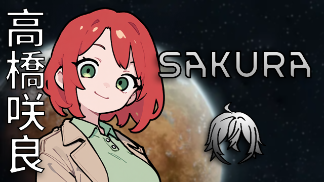
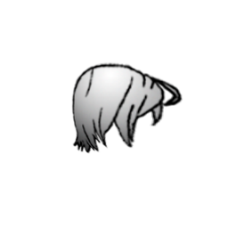

# Rimworld Sakura's Hair

A mod that adds hair from my original character Sakura to Rimworld.

## Status
Hair is working and in the game. I'd like to improve the hair texture and add more hair styles in the future.

## Supported versions
RimWorld 1.0 through 1.7. Per-version notes are in [CHANGELOG.md](CHANGELOG.md).

## Installation

1. Download on the [Steam Workshop](https://steamcommunity.com/sharedfiles/filedetails/?id=3007906745)
2. Enable the mod in the mod menu in the game
3. Enjoy!

## Textures



## Packaging

Workshop uploads are built from a staging folder, not from the repo root:

```sh
python3 scripts/package_mod.py .
```

That writes `dist/SakurasHair/`, which is the folder to hand to the uploader. It holds only what the game loads: `About/`, the versioned def folders and `Textures/`.

The `PSD/` source art and the `.git` folder stay in this repository and are never copied into the staging folder, so they don't count against the Workshop item size. The script fails if source art or `.git` ever ends up in the staging folder, so the exclusion cannot silently regress.

## Checks

```sh
python3 scripts/validate_mod.py .
```

Validates the mod without the game installed: XML well-formedness, `packageId`, `supportedVersions`, texture paths for every direction, def name collisions per load set, and preview plus icon sizes. CI runs it on every push.
